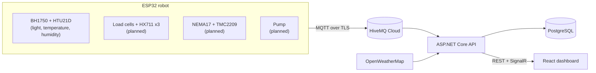

# Floriva

**An autonomous, IoT-connected watering robot for potted plants.**

Floriva is a full-stack embedded systems project: custom ESP32 firmware written in C, a cloud backend, and a real-time web dashboard. A motorised carriage travels along a linear rail and waters up to three pots. Each pot rests on a load cell, so soil moisture is inferred from weight rather than from corrosion-prone soil probes.

It is being developed as a bachelor's thesis project and is **work in progress**. The environmental monitoring pipeline is complete end to end; the robot's motion, weighing and watering logic are under development.

---

## Highlights

- **Firmware in C on ESP-IDF** (no Arduino layer). Sensor drivers are written from datasheets as reusable ESP-IDF components.
- **Secure, event-driven telemetry**: ESP32 → MQTT over TLS (HiveMQ Cloud) → ASP.NET Core → PostgreSQL, with live push to the browser over SignalR.
- **Real-time dashboard** built with React 19, TypeScript and Tailwind CSS v4: live readings, 24-hour history charts, weather forecast and skeleton loading states.
- **Cloud deployment** to Azure App Service through GitHub Actions, with a separate manual workflow for database migrations.
- **Weight-based soil moisture sensing** (load cells + HX711) chosen for long-term reliability over resistive/capacitive probes.

## System architecture

## Project status

| Area | Status |
|---|---|
| BH1750 (light) and HTU21D (temperature/humidity) drivers | Done |
| Wi-Fi station, MQTT over TLS publisher | Done |
| Backend: MQTT ingest, persistence, live push, weather proxy | Done |
| Dashboard: environment page, history charts, weather forecast | Done |
| HX711 load-cell driver, calibration, filtering | Planned |
| Stepper motion, homing with limit switches | Planned |
| Pump control, watering state machine, fault handling | Planned |
| Plants page, AUTO/MANUAL mode, watering history | Planned |
| Plant database integration (Trefle API) | Planned |
| Drying-rate prediction model | Planned |

## Hardware

| Function | Component |
|---|---|
| Controller | ESP32 |
| Soil moisture (by weight) | 5 kg bar load cells with HX711 amplifiers, one per pot |
| Environment sensing | HTU21D (temperature, humidity), BH1750 (light) |
| Linear motion | MGN12H rail (400 mm) with carriage, GT2 belt, NEMA17 stepper with TMC2209 driver |
| Homing and end stops | SS-5GL-F micro limit switches |
| Power | 12 V DC adapter, MP1584EN buck converters for 5 V |
| Water | Submersible pump (provisional) |

## Repository layout

| Path | Description |
|---|---|
| [`firmware/`](firmware/) | ESP32 firmware (ESP-IDF, C) |
| [`backend/`](backend/) | ASP.NET Core API, MQTT subscriber, SignalR hub, PostgreSQL |
| [`frontend/`](frontend/) | React + TypeScript web dashboard |
| [`.github/workflows/`](.github/workflows/) | CI/CD: backend deployment and database migration |

Each directory has its own README with setup instructions.

## Getting started

1. **Firmware**: install ESP-IDF 5.5.x, create the Wi-Fi and MQTT configuration headers and build. See [`firmware/README.md`](firmware/README.md).
2. **Backend**: provide MQTT, weather and database settings through environment variables, then `dotnet run`. See [`backend/README.md`](backend/README.md).
3. **Frontend**: point `VITE_API_BASE_URL` at the backend and run `npm run dev`. See [`frontend/README.md`](frontend/README.md).

## Technology

C · ESP-IDF · FreeRTOS · I²C · MQTT/TLS · C# · ASP.NET Core · Entity Framework Core · PostgreSQL · SignalR · React · TypeScript · Vite · Tailwind CSS · Recharts · GitHub Actions · Azure App Service

